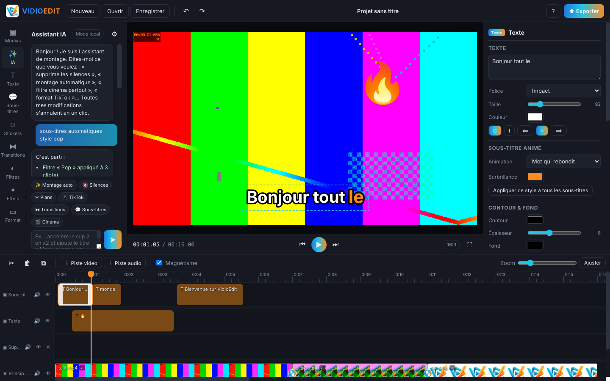

<p align="center">
  
</p>

<p align="center">
  <b>Éditeur vidéo gratuit et open source pour Windows, inspiré de CapCut — avec un assistant IA de montage automatique.</b><br>
  <a href="https://github.com/ck526438-lgtm/vidioedit/releases/latest"><b>⬇ Télécharger pour Windows</b></a>
</p>

---



## ✨ Fonctionnalités

**Montage**
- Timeline multipiste : vidéo principale, superpositions, textes, sous-titres, pistes audio illimitées
- Glisser-déposer depuis l'Explorateur, miniatures et formes d'onde
- Couper (`S`), supprimer, dupliquer, rogner, déplacer entre pistes, piste principale magnétique
- **Images clés (◆)** sur la position, l'échelle, la rotation et l'opacité, avec courbe adoucie ou linéaire
- **Recadrage**, miroir, ajuster / remplir le cadre, **fond flou** automatique pour le format vertical
- **Figer l'image**, **lecture à l'envers**, vitesse de 0,25× à 4×
- Annuler / rétablir illimité, zoom de la timeline (`Ctrl` + molette)

**Transitions & effets**
- **19 transitions** entre clips : fondu, fondu noir/blanc, flash, balayages, pousser, zoom, flou, cercle, portes, tourbillon, glitch
- **10 effets vidéo** : Ken Burns, pulsation, secousse, glitch, RVB décalé, VHS, stroboscope, kaléidoscope, pixels, grain film
- 12 filtres + réglages (luminosité, contraste, saturation, teinte, flou, sépia, vignette)
- Animations d'entrée/sortie (zoom, glissement, rotation, rebond, machine à écrire…)

**Texte, sous-titres & autocollants**
- **Sous-titres automatiques** avec Whisper (sur votre PC, gratuit, hors-ligne) : 5 styles animés (karaoké, surligné, pop, mot à mot, sobre), 15 langues dont le français
- 10 styles de texte, retour à la ligne automatique
- 40 autocollants emoji animés

**Audio** — volume jusqu'à 200 %, fondus, détacher l'audio, **réduction du bruit de fond**

**Formats** — 16:9 (YouTube), 9:16 (TikTok / Reels / Shorts), 1:1, 4:5, 4:3, 21:9

**Export rapide** — MP4 H.264 + AAC jusqu'en 4K / 60 ips, décodage FFmpeg et **accélération matérielle** NVIDIA NVENC, Intel Quick Sync ou AMD AMF détectée automatiquement

**Projets** — fichiers `.vedit` (s'ouvrent par double-clic)

## 🤖 Assistant IA

Onglet **✨ IA** : décrivez le montage, l'assistant l'applique (et tout s'annule en un clic).

| Exemple de demande | Effet |
|---|---|
| « Montage automatique » | Supprime les silences, ferme les trous, ajoute transitions, effets et titre |
| « Sous-titres automatiques en français » | Transcrit la parole et crée des sous-titres animés |
| « Supprime les silences » | Analyse l'audio et retire les blancs |
| « Coupe aux changements de plan » | Détecte les scènes et découpe |
| « Transitions glitch partout » | Transition sur chaque coupe |
| « Effet secousse sur le clip 2 » | Effet vidéo sur un clip |
| « Zoom progressif sur le clip 1 » | Images clés automatiques |
| « Format TikTok et fond flou » | Passe en 9:16 et remplit les bandes noires |
| « Enlève le bruit de fond » | Réduction du bruit à l'export |
| « Ajoute un sticker 🔥 » | Autocollant animé au curseur |

Moteurs disponibles (⚙ dans l'onglet IA) :
- **Local** — par défaut, hors-ligne, gratuit : comprend les commandes en français ci-dessus
- **Ollama** — IA locale gratuite sur votre PC ([ollama.com](https://ollama.com)), pour des demandes libres
- **Compatible OpenAI** — OpenAI, Groq, OpenRouter, Mistral, Gemini, LM Studio…
- **Anthropic Claude**

Les clés API sont chiffrées sur votre ordinateur (Windows DPAPI).

### Sous-titres : modèles Whisper

Au premier usage, VidioEdit télécharge le modèle choisi depuis Hugging Face : Très rapide (75 Mo), Rapide (142 Mo), Précis (466 Mo, recommandé pour le français) ou Très précis (1,5 Go). Ensuite tout fonctionne hors-ligne. Le moteur « API » utilise à la place le service configuré dans l'onglet IA (ex. Groq `whisper-large-v3-turbo`, OpenAI `whisper-1`).

## ⬇ Installation

Téléchargez dans [Releases](https://github.com/ck526438-lgtm/vidioedit/releases/latest) :
- `VidioEdit-Setup-x.y.z.exe` — installateur (raccourcis bureau et menu Démarrer)
- `VidioEdit-Portable-x.y.z.exe` — version portable, sans installation

> L'application n'est pas signée : si Windows SmartScreen s'affiche, cliquez sur **Informations complémentaires → Exécuter quand même**.

## ⌨ Raccourcis

| Touche | Action |
|---|---|
| `Espace` | Lecture / pause |
| `S` | Couper au curseur |
| `Suppr` | Supprimer le clip |
| `Ctrl+D` | Dupliquer |
| `Ctrl+Z` / `Ctrl+Y` | Annuler / rétablir |
| `←` `→` | Image précédente / suivante (`Maj` : 1 s) |
| `Ctrl+S` / `Ctrl+O` | Enregistrer / ouvrir |
| `Ctrl+I` | Importer |
| `Ctrl+E` | Exporter |

## 🛠 Développement

```bash
git clone https://github.com/ck526438-lgtm/vidioedit.git
cd vidioedit
npm install
npm start          # lancer l'application
npm run dist       # créer l'installateur Windows dans dist/
```

Pour les sous-titres en développement, placez `whisper-cli(.exe)` de [whisper.cpp](https://github.com/ggml-org/whisper.cpp) dans `vendor/whisper/` (la CI le compile automatiquement pour Windows).

Architecture :
- `main.js` — processus principal Electron : fichiers, FFmpeg (analyse, décodage, export, silences, scènes, inversion), Whisper, appels IA
- `src/render.js` — moteur de composition partagé entre l'aperçu et l'export (transitions, images clés, effets, sous-titres) : ce que vous voyez = ce que vous exportez
- `src/app.js` — interface : timeline, inspecteur, lecture, export
- `src/ai.js` — assistant IA : compréhension des commandes et exécution des actions
- `src/presets.js` — filtres, styles de texte, animations, formats

Publier une nouvelle version : changez `version` dans `package.json` et poussez sur `main` — GitHub Actions compile et publie les `.exe` dans une release `v<version>` automatiquement.

## 🗺 Feuille de route

- Suppression d'arrière-plan par IA (sans fond vert) et incrustation chroma
- Recadrage automatique qui suit le sujet (9:16)
- Synthèse vocale, changeur de voix, baisse auto de la musique sous la voix
- Masques et modes de fusion, courbes de couleur et LUT
- Bibliothèque de musiques et effets libres de droits, modèles de montage
- Export GIF / WebM, publication directe TikTok / YouTube

Les contributions sont les bienvenues : ouvrez une *issue* ou une *pull request*.

## 📄 Licence

[MIT](LICENSE) — libre et gratuit, y compris pour un usage commercial.
VidioEdit utilise [Electron](https://www.electronjs.org/) et [FFmpeg](https://ffmpeg.org/) (via `ffmpeg-static`, licence GPL).
